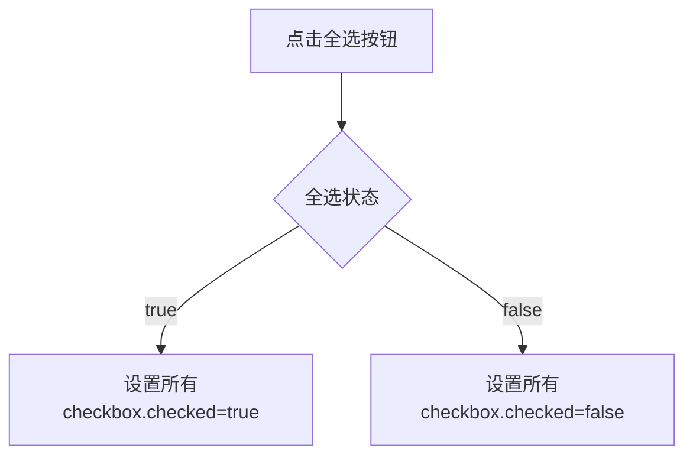

## 核心概念

### 元素(Element) vs 节点(Node)

- 元素：HTML文档中的具体标签（如 `<div>` `<button>`）
- 节点：文档中的所有组成部分（包括元素、文本、注释等）
- 关系：元素是节点的一种特殊类型

### 常用DOM操作
1. **禁用元素**：`element.disabled = true` 适用于表单元素
2. **内容操作**：`innerHTML` / `textContent`
3. **样式控制**：`style.property` / `classList`
4. **事件处理**：`addEventListener`

## 实战案例

### 案例1：动态表格生成
```javascript
// 1. 创建表格骨架
const table = document.createElement('table');

// 2. 批量生成数据行
users.forEach(user => {
  const row = table.insertRow();
  row.innerHTML = `<td>${user.name}</td><td>${user.age}</td>`;
});

// 3. 添加到页面
document.body.appendChild(table);
```

### 案例2：颜色切换器
```html
<div class="color-picker">
  <button data-color="#ff0000">红色</button>
  <button data-color="#00ff00">绿色</button>
</div>

<script>
document.querySelectorAll('button').forEach(btn => {
  btn.addEventListener('click', () => {
    document.body.style.backgroundColor = btn.dataset.color;
  });
});
</script>
```

## 常见问题
1. **元素找不到**：检查选择器拼写/元素加载时机
2. **事件不触发**：确认元素已渲染后再绑定事件
3. **样式不生效**：优先使用class操作代替直接style修改

## 进阶练习
| 练习项目 | 关键技能 | 实现思路 |
|---------|---------|----------|
| 留言板 | 节点创建/事件委托 | 1. 获取输入 2. 创建元素 3. 添加删除功能 |
| 全选功能 | 属性批量操作 | 1. 获取所有复选框 2. 联动全选状态 |
| 分类筛选 | 数据过滤/显示控制 | 1. 数据分类 2. 显示切换动画 |

流程图示例（全选功能）：

对象.disabled = true 禁用按钮/搜索框

## 循环方法对比

### 基本用法
```javascript
// forEach写法
const arr = [1, 2, 3, 4];
arr.forEach(alert);

// 传统for循环写法
const arr = [1, 2, 3, 4];
for (let k = 0, length = arr.length; k < length; k++) {
  alert(arr[k]); // 注意变量名一致性
}
```

### ForEach参数解析
| 参数位置 | 说明                  | 类型       |
|---------|---------------------|------------|
| 第1个参数 | 当前遍历的数组元素         | any       |
| 第2个参数 | 当前元素的索引（从0开始）   | number    |
| 第3个参数 | 正在遍历的数组本身        | Array     |

### 运行示例
```javascript
const letters = ['a', 'b', 'c', 'd'];
letters.forEach((item, index, array) => {
  console.log(item, index, array);
});

/* 输出结果：
a 0 ['a', 'b', 'c', 'd']
b 1 ['a', 'b', 'c', 'd']
c 2 ['a', 'b', 'c', 'd']
d 3 ['a', 'b', 'c', 'd']
*/

## DOM 文档模型

### 核心概念

- **文档(Document)**：整个页面的根节点，通过 `document` 对象访问
- **元素(Element)**：HTML 标签对应的对象（如 `<div>`、`<p>`）
- **节点(Node)**：文档中的所有组成部分（包括元素、文本、注释等）

### 元素获取方法
| 方法名                  | 返回类型       | 使用场景               |
|-------------------------|----------------|------------------------|
| `getElementById()`      | 单个元素对象   | 精确查找唯一元素       |
| `getElementsByTagName()` | HTML集合       | 批量操作同类型元素     |

```javascript
// 通过ID获取单个元素
const header = document.getElementById('mainHeader');

// 通过标签名获取所有段落
const paragraphs = document.getElementsByTagName('p');
```

### 注意事项
1. **加载顺序**：脚本应放在<body>底部或使用DOMContentLoaded事件
2. **方法规范**：注意方法名大小写（如`getElementById`的最后一个'd'小写）
3. **返回类型**：
   - `null` 表示元素未找到
   - 集合需通过索引访问具体元素（如`paragraphs[0]`）

### 调试技巧
```javascript
// 查看元素详细信息
console.dir(header);
/* 输出示例：
HTMLHeadingElement {
  id: 'mainHeader',
  classList: DOMTokenList [ ],
  ...
}*/
```
document.getElementsbyTageName(div[1])返回第二个元素值

获取父元素中的子元素：
1-可以给父元素定ID，在父元素中查找元素(

这是html中的元素`<ul id="a">   `

``` javascript
var ul=document.getElementByid('a');
console.log( ul.getElementsByTageName('li'))

var ul=document.getElementsByTagName('ul')
console.log(ul[0].getElementsByTagName('li'))
)
```

通过类名获取元素（HTML5）
` document.getElmentsByClassName('box'); `

指定选择器的第一个元素对象（选择器需要加符号申明）

```javascript
document.querySelector('.box')//获取第一个类选择器,也可获取第一个标签选择器
//所有元素对象
document.querySelectorAll('.box')//获取第所有类选择器
```

获取body元素
`document.body;`

获取html元素
`document.documentElement;`